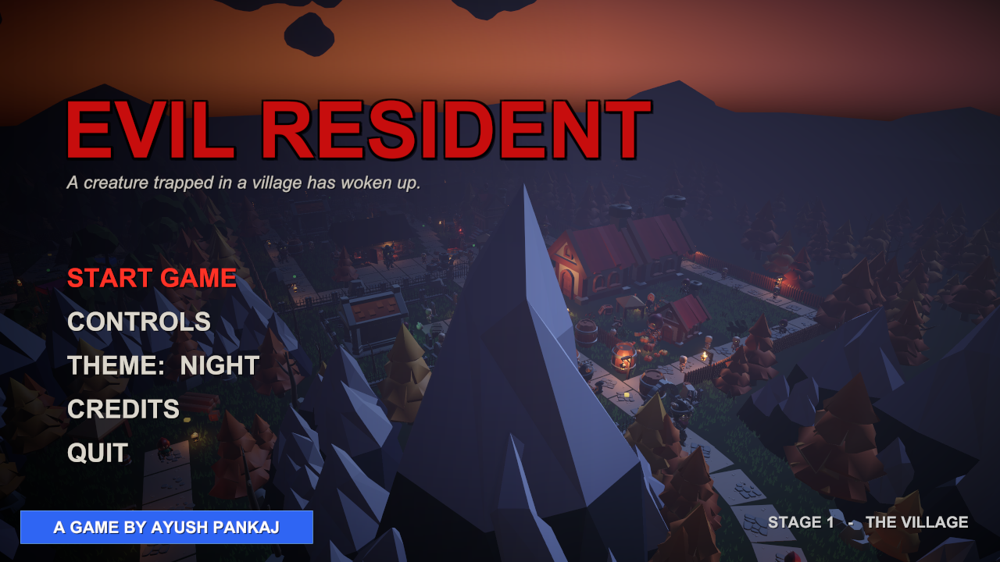
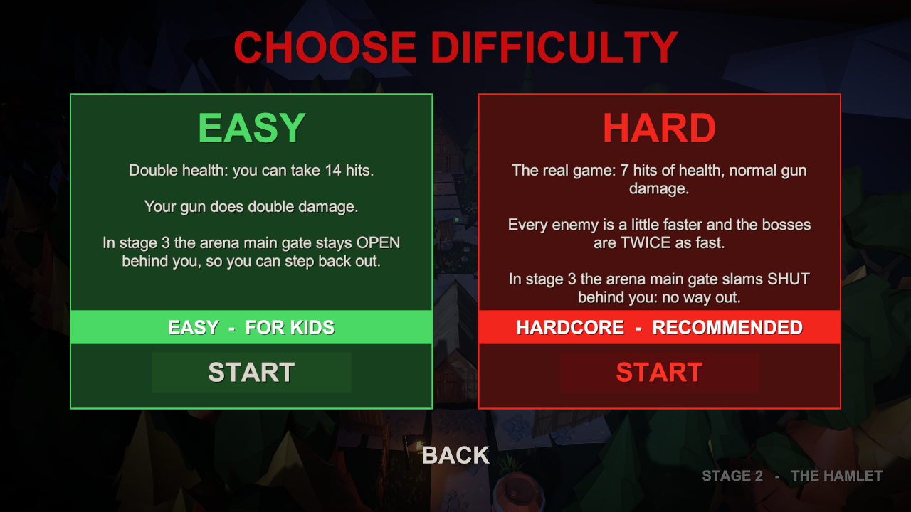
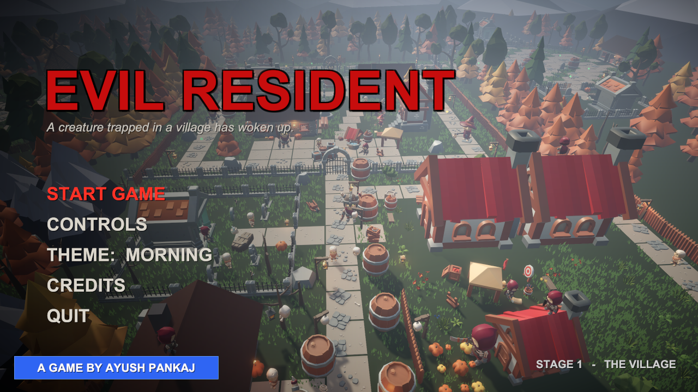
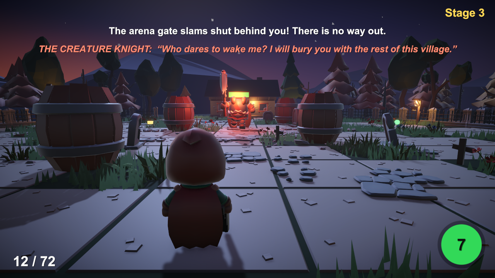
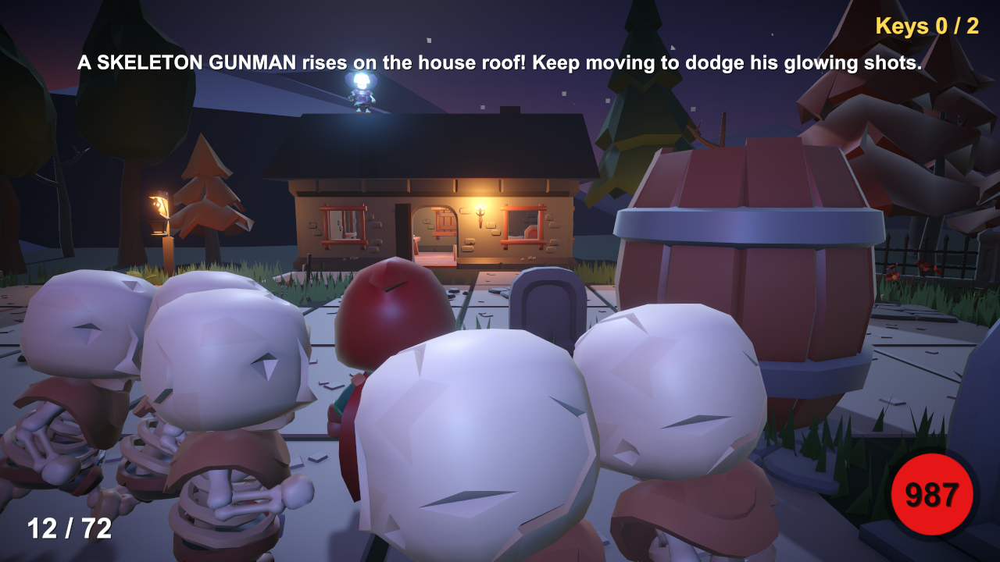

# EVIL RESIDENT — a 3D game

> *A creature trapped in a village has woken up.*

**Evil Resident** is a third-person survival shooter made in **Unity 6 (URP)** by **Ayush Pankaj**, solo game developer.
Fight through a haunted village full of skeletons, find the keys, reach the arena — and kill the creature, or get killed.

### ▶ Play it
**Play in your browser or download for Windows on itch.io:** https://YOUR-ITCH-NAME.itch.io/evil-resident

---

## The game

| Stage | What happens |
|---|---|
| **Stage 1 – The Village** | Gunmen on the roofs, graveyards that wake up, a door that bursts open. One gunman carries a key; the other key is hidden in a random house. |
| **Stage 2 – The Hamlet** | Shield Skeletons (shoot them from the side or back) and Bone Throwers (dodge their bones). They carry the two keys to the arena gate. |
| **Stage 3 – The Arena** | The dead rise from two graveyards. Clear them all to find the final key… |
| **The bosses** | **THE CREATURE KNIGHT**, then — after 60 seconds to gear up — **THE REAL CREATURE**. They talk, summon the dead, and get enraged. |

**Also in the game**
- Story intro with music, checkpoints for every stage, and a pause menu that always shows your current objective
- Special enemies: the **Crawler** (a jump scare in every stage) and the **Exploder** (guards every key — it bursts 1 second after it stops)
- **Easy** (for kids: double health, double damage, the arena gate stays open) and **Hard** (recommended: faster enemies, bosses twice as fast, the arena gate slams shut behind you)
- **Night** and **Day** themes — beat the game at night to unlock day

| | |
|---|---|
|  |  |
|  |  |

## Controls

| Key | Action |
|---|---|
| W A S D / arrow keys | Move |
| Shift (hold) | Run |
| Mouse | Look around |
| Right mouse (hold) | Aim (you can walk while aiming) |
| Left mouse (while aiming) | Shoot |
| R | Reload |
| Walk over an item | Pick up keys, ammo and health |
| Esc or P | Pause menu / objective |

## The code

All gameplay code is C# in [`Assets/Game/Scripts`](Assets/Game/Scripts):

| Script | What it does |
|---|---|
| `GameManager.cs` | Levels, keys, checkpoints, difficulty, objectives, pause, win/lose |
| `PlayerController.cs`, `ThirdPersonCamera.cs` | Movement, aiming, shooting, health; the over-the-shoulder camera |
| `EnemyAI.cs` | All skeletons: normal, big, Shield, Bone Thrower, Crawler, Exploder |
| `BossAI.cs` | Both bosses: three phases, warning circles, summons, boss speech |
| `RoofGunner.cs`, `SoulGunner.cs` | The roof gunmen (laser aim) and the boss's skeleton gunman (slow dodgeable shots) |
| `GraveyardSpawner.cs`, `AmbushTrigger.cs` | Graveyards that raise the dead, the crawler jump scares |
| `GameMenu.cs`, `Hud.cs`, `Theme.cs` | Main menu, story intro, difficulty, credits, pause menu, HUD, day/night |
| `Sfx.cs`, `Pickup.cs`, `Gate.cs` | Sounds, pickups, gates |

The whole level is **generated by code**: [`Assets/Game/Editor/VillageBuilder.cs`](Assets/Game/Editor/VillageBuilder.cs)
(**Tools ▸ Village ▸ Rebuild Level** in the Unity editor) places every house, path, fence, enemy and pickup.

## Open the project

1. Unity **6000.6.8f1** (Unity 6) with the Universal Render Pipeline.
2. Import **RPG Poly Pack – Lite** (free on the Unity Asset Store) into `Assets/ThirdParty/RPGPolyPackLite` — Asset Store content can't be shared in this repo.
3. Open `Assets/Game/Scenes/Village.unity` and press Play.

## Credits

- **Game, design, levels, gameplay and story:** Ayush Pankaj — [github.com/ayushpankaj20-tech](https://github.com/ayushpankaj20-tech)
- **3D assets:** KayKit by Kay Lousberg (Adventurers, Skeletons, Halloween, Dungeon, Medieval) · RPG Poly Pack – Lite (Unity Asset Store)
- **Sound:** Kenney (Impact Sounds, RPG Audio) · Minecraft zombie sounds · Quake 1 zombie pain · town zombie call · ZG survival victory & defeat · Tom scream · Desert Eagle (CS) & gunshot
- **Music:** *Meaningful Love* (slowed instrumental)
- **Code:** C# in Unity
